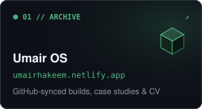

  

  
  
  

 

Final-year CS undergraduate at NUML Islamabad building full-stack web apps, browser developer tools, Python automation, and WebGL interfaces. Previously taught Python and CS fundamentals at Benchmark School, interned at Air Tech Solutions, and delivered 50+ Java, C++, and Python builds on Fiverr.

- **Focus:** Backend APIs (`FastAPI`, `Flask`, `Node.js`), browser tooling (`TypeScript`, `React`, `Next.js`), and interactive graphics (`Three.js`, `GLSL`).
- **Portfolios:** [umairhakeem.netlify.app](https://umairhakeem.netlify.app) · [cerndev.netlify.app](https://cerndev.netlify.app) · [umairhakeem3d.netlify.app](https://umairhakeem3d.netlify.app)
- **Contact:** [malikumairhakim@outlook.com](mailto:malikumairhakim@outlook.com) · [LinkedIn](https://www.linkedin.com/in/umairsim/)

 

  

 

### Selected Work

| Project | Summary | Stack | Links |
| :--- | :--- | :--- | :--- |
| **CodeSpace** | Browser IDE with multi-file editing and live Python/JS execution with zero local setup. | React, TypeScript, Monaco, Python | [Live](https://webcodespace.netlify.app) · [Repo](https://github.com/Umairism/codespace) |
| **3D Portfolio** | Scroll-driven WebGL showcase with custom GLSL shaders, bloom pass, and interactive 3D spiral. | TypeScript, Three.js, GLSL, GSAP | [Live](https://umairhakeem3d.netlify.app) · [Repo](https://github.com/Umairism/3D_Portfolio) |
| **CernDev Studio** | Client-facing engineering studio featuring Three.js particle logos and procedural shader scenes. | Next.js, Three.js, Web Audio | [Live](https://cerndev.netlify.app) · [Repo](https://github.com/Umairism/Dev_Portfolio) |
| **Aircrack-NG GUI** | Web dashboard wrapping the Aircrack-NG wireless auditing suite with async task queueing. | React, TypeScript, FastAPI, Redis | [Repo](https://github.com/Umairism/Aircrack_GUI) |
| **LinuxOS Desktop** | Zero-dependency browser desktop with draggable windows, task switcher, and file explorer. | Vanilla JS, HTML5, CSS3 | [Live](https://linuxos.netlify.app) · [Repo](https://github.com/Umairism/linuxos-desktop) |
| **LockChain** | Custom blockchain ledger for issuing and verifying tamper-proof academic certificates. | React, TypeScript, Flask, Python | [Repo](https://github.com/Umairism/blockchain-certificate-verification) |
| **Portable AI Agent** | Offline-first local assistant with self-contained PyTorch inference and zero cloud dependency. | Python, PyTorch | [Repo](https://github.com/Umairism/Porable-Ai-Agent) |
| **SlimeTube** | Media streaming frontend supporting offline video caching via IndexedDB. | React, TypeScript, Vite, IndexedDB | [Live](https://flixii.netlify.app) · [Repo](https://github.com/Umairism/SlimeTube) |
| **KDE Theme Installer** | CLI utility to fetch, unpack, and apply KDE Plasma themes and icons from URLs or archives. | Python | [Repo](https://github.com/Umairism/Theme-Installer-For-KDE) |

<strong>Interactive Learning Platforms (6 self-built CS &amp; language apps)</strong>

 

- **[AI Lean](https://ai-lean.netlify.app)** — Interactive ML & AI concepts with live exercises
- **[CompGrafik](https://compgrafik.netlify.app)** — Computer graphics courseware with interactive WebGL demos
- **[Parse Flow](https://parse-flow.netlify.app)** — Compiler construction & CFG parsing with live parse-tree visualizations
- **[DBMS Learn](https://dbms-learn.netlify.app)** — Relational schema design, ER diagrams, and normalization tools
- **[SPM Learn](https://spm-learn.netlify.app)** — Software project management covering Agile, Scrum, and PMBOK
- **[German Lern](https://german-lern.netlify.app)** — Vocabulary drills and grammar tracking

---

Muhammad Umair Hakeem · Open to full-stack &amp; backend software engineering roles · [malikumairhakim@outlook.com](mailto:malikumairhakim@outlook.com) · [LinkedIn](https://www.linkedin.com/in/umairsim/)
