

  

 

  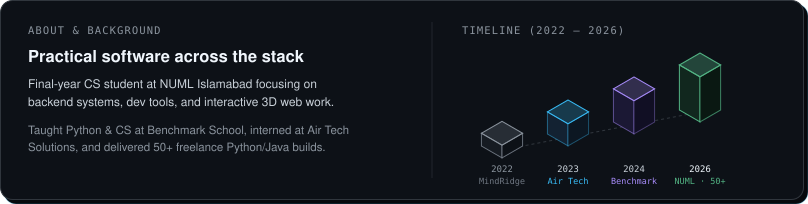

 

  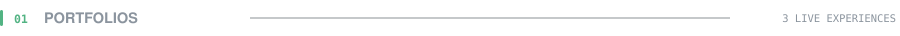

 <a href="https://cerndev.netlify.app"></a> 

 

  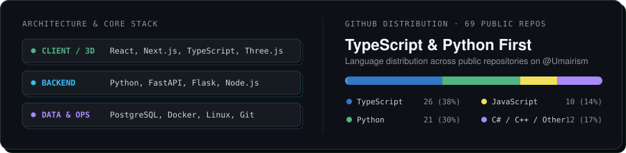

 

  

<a href="https://github.com/Umairism/codespace">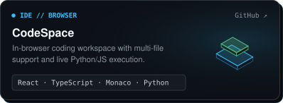</a> <a href="https://github.com/Umairism/3D_Portfolio">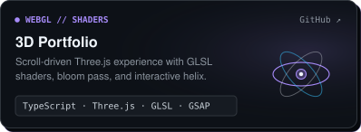</a>

<a href="https://github.com/Umairism/Dev_Portfolio">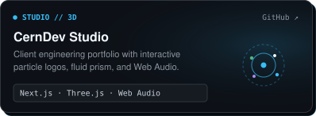</a> <a href="https://github.com/Umairism/Aircrack_GUI">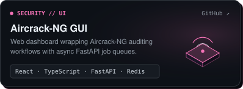</a>

<a href="https://github.com/Umairism/linuxos-desktop">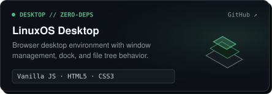</a> <a href="https://github.com/Umairism/blockchain-certificate-verification">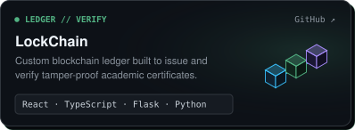</a>

<a href="https://github.com/Umairism/Porable-Ai-Agent">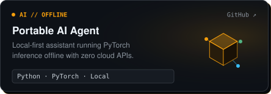</a> <a href="https://github.com/Umairism/SlimeTube">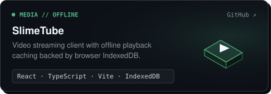</a>

 

  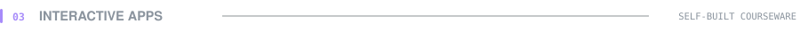

<a href="https://ai-lean.netlify.app">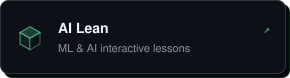</a> <a href="https://compgrafik.netlify.app">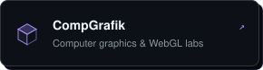</a> <a href="https://parse-flow.netlify.app">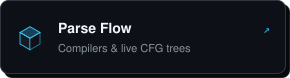</a>

<a href="https://dbms-learn.netlify.app">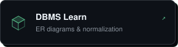</a> <a href="https://spm-learn.netlify.app">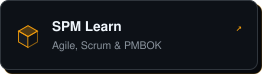</a> <a href="https://german-lern.netlify.app">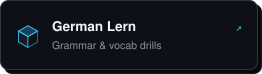</a>

 

  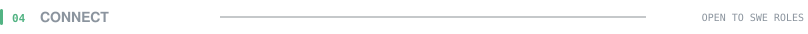

<a href="https://github.com/Umairism">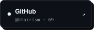</a> <a href="https://www.linkedin.com/in/umairsim/">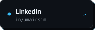</a> <a href="mailto:malikumairhakim@outlook.com">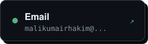</a> <a href="https://umairhakeem.netlify.app">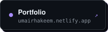</a>

